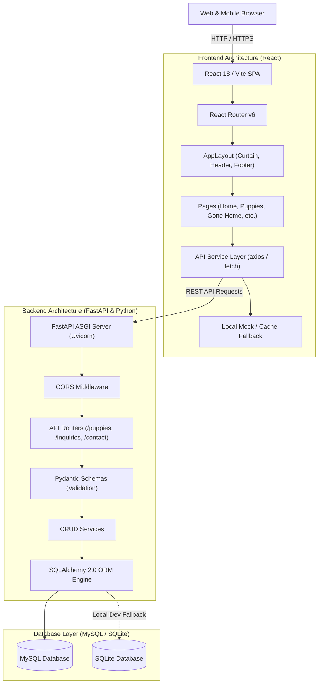

# System Architecture: TeddyPups U.A.E. Full-Stack Clone

This document details the software architecture, data models, component hierarchy, API contract, and deployment topologies for the TeddyPups U.A.E. website clone.

---

## 1. High-Level Architecture

The application adopts a decoupled, modern full-stack web architecture:
- **Presentation Layer:** React 18 Single Page Application (SPA) bundled with Vite, offering sub-millisecond client transitions, responsive CSS3 tokenized layouts, SVG vector animations, and client-side caching.
- **API & Application Layer:** Python 3.14+ running FastAPI and Uvicorn, exposing structured RESTful endpoints with strict Pydantic v2 schemas for request validation and serialization.
- **Persistence Layer:** MySQL 8.0 relational database queried through SQLAlchemy 2.0 ORM, featuring automated migrations/initialization, foreign key integrity, and indexing. For seamless local execution across varied environments, a transparent SQLite fallback driver is supported when MySQL credentials are not specified.



---

## 2. Frontend Component Hierarchy

```
<App>
  └── <BrowserRouter>
        └── <AppLayout>
              ├── <Curtain />             (Running Puppy Animation on Load)
              ├── <SiteHeader />          (Scalloped Hem, Nav Links, WA CTA)
              │     └── <MobileMenu />    (Fullscreen Accessible Dialog)
              ├── <Routes>
              │     ├── Route "/": <HomePage />
              │     │     ├── <HeroSection />
              │     │     ├── <PuppyShowcase />
              │     │     ├── <AdoptionPaths />
              │     │     ├── <JourneySteps />
              │     │     ├── <TrustBadges />
              │     │     ├── <FamilyPreview />
              │     │     └── <FaqPreview />
              │     ├── Route "/puppies": <PuppiesPage />
              │     │     ├── <PuppyFilterBar />
              │     │     └── <PuppyGrid> -> [<PuppyCard />, ...]
              │     ├── Route "/puppies/:slug": <PuppyDetailPage />
              │     │     ├── <MediaGallery />
              │     │     ├── <PuppySpecs />
              │     │     ├── <HealthChecklist />
              │     │     └── <InquiryDrawer />
              │     ├── Route "/gone-home": <GoneHomePage />
              │     │     ├── <BoothMascot />
              │     │     └── <TicketGrid> -> [<TicketCard />, ...]
              │     ├── Route "/happy-families": <HappyFamiliesPage />
              │     │     └── <MasonryGallery />
              │     ├── Route "/how-it-works": <HowItWorksPage />
              │     │     ├── <ShowroomGuide />
              │     │     ├── <OverseasImportGuide />
              │     │     └── <CargoCareInfo />
              │     ├── Route "/faq": <FaqPage />
              │     │     └── <FaqBoard> -> [<FaqAccordion />, ...]
              │     └── Route "/contact": <ContactPage />
              │           ├── <LetterContactForm />
              │           └── <ShowroomLocationCard />
              └── <SiteFooter />          (Hill Silhouette, Moon, Stars, Mascot)
```

---

## 3. Data Flow & State Management

1. **Server-State (Puppies & Metadata):**
   - The React frontend centralizes all HTTP calls within `src/services/api.js`.
   - On mount, `PuppiesPage` triggers `fetchPuppies(filterParams)`.
   - The query parameters (`breed`, `gender`, `status`) map directly to FastAPI router query args.
   - If the backend is loading or unavailable, the service provides an instant offline cache matching the reference website content to ensure 100% uptime and resilience.
2. **Interactive UI State:**
   - Active filters and search queries are managed with React `useState` and URL search parameters for shareable deep linking (`/puppies?breed=maltipoo`).
   - Accordion expansion states on the FAQ page are independently toggled using stateful item identifiers.
   - The "Dear TeddyPups" letter form maintains a real-time controlled form state, dynamically reflecting typed values inside the letter paper display.
3. **Inquiry Submissions:**
   - Submitted contact letters and puppy reservation forms execute `POST /api/inquiries` or `POST /api/contact`.
   - FastAPI intercepts payload, validates phone numbers, email syntax, and required strings via Pydantic.
   - SQLAlchemy commits the transaction to MySQL.
   - The frontend displays a warm celebratory confirmation modal and offers a pre-filled direct WhatsApp handoff.

---

## 4. REST API Endpoint Specifications

| Method | Endpoint | Description | Request Body | Response Format |
|---|---|---|---|---|
| `GET` | `/api/health` | Health and DB status | None | `{"status": "ok", "db": "connected"}` |
| `GET` | `/api/puppies` | List active puppies | Query params (`breed`, `gender`, `status`) | `Array<PuppySummary>` |
| `GET` | `/api/puppies/{slug}` | Detailed puppy dossier | Path param `slug` | `PuppyDetail` with media & records |
| `GET` | `/api/gone-home` | Adopted puppy ticket records | None | `Array<GoneHomePuppy>` |
| `GET` | `/api/testimonials` | Client reviews & stories | None | `Array<Testimonial>` |
| `GET` | `/api/faqs` | FAQs categorized | Query param `category` | `Array<FaqItem>` |
| `POST` | `/api/inquiries` | Submit puppy reservation/inquiry | `InquiryCreateSchema` | `InquiryResponseSchema` (201 Created) |
| `POST` | `/api/contact` | Submit contact letter | `ContactLetterSchema` | `ContactResponseSchema` (201 Created) |

---

## 5. Database Schema & Relational Integrity

### Entities
1. **`puppies`**: Stores unique puppy records with biographical details, origin, pricing, and cover image metadata.
2. **`puppy_media`**: Relational table holding high-resolution image URLs, dimensions, and MP4 videos linked by `puppy_id` foreign key.
3. **`inquiries`**: Stores adoption requests and WhatsApp consultation reservations linked optionally to specific puppies.
4. **`contact_submissions`**: Stores letterhead contact submissions sent from `/contact`.
5. **`faqs`**: Stores categorized frequently asked questions.
6. **`testimonials`**: Stores happy family photos, customer names, and quotes.

---

## 6. Error Handling Strategy

1. **Frontend:**
   - Centralized Axios/fetch interceptor intercepting HTTP 400, 404, 422, and 500 errors.
   - User-friendly error cards with retry actions and direct WhatsApp fallback if backend is unreachable.
   - Comprehensive form field validation with inline alerts before network submission.
2. **Backend:**
   - Global exception handlers for `SQLAlchemyError` and `RequestValidationError`.
   - Standardized JSON error response format:
     ```json
     {
       "error": true,
       "status_code": 422,
       "message": "Validation error",
       "details": [...]
     }
     ```
3. **CORS:**
   - Configured via FastAPI's `CORSMiddleware` to authorize requests from `http://localhost:5173`, `http://localhost:3000`, and production deployment origins.

---

## 7. Deployment Architecture

- **Frontend:** Built with `npm run build` producing static HTML5/CSS/JS artifacts deployable to Vercel, Netlify, or AWS S3/CloudFront. Supports client-side SPA fallback routing (`_redirects` or `vercel.json`).
- **Backend:** Packaged with `uvicorn app.main:app --host 0.0.0.0 --port 8000` runnable on Railway, Render, Fly.io, or standard Linux VPS with systemd/Docker.
- **Database:** Hosted on AWS RDS MySQL, PlanetScale, or local MySQL instance, configured via `DATABASE_URL` environment variable.
